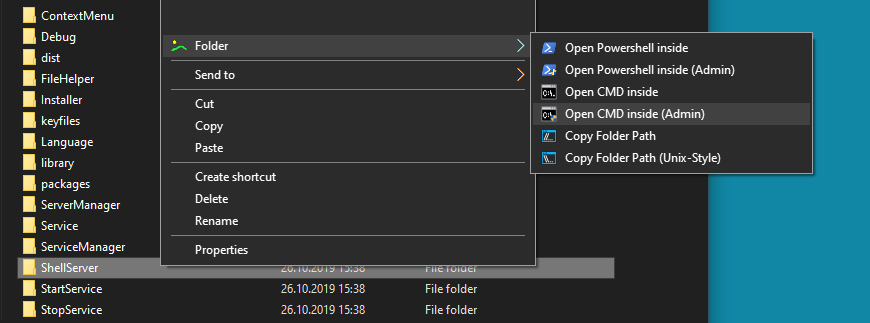

<p align="center">
<a href="./assets/Sonnenberg-Logo.png"></a>
</p>
<h2 align="center">Sonnenberg</h2>
<p align="center">
A Tiny But Useful Windows Explorer Extension For Developers
  <br>
  <br>
<a href="#get-setup-file"><strong>Install or build Sonnenberg</strong></a>
  <br>
  <br>
<a href="https://github.com/demispatti/Sonnenberg/issues/new?template=bug.md" target="_blank">Report A Bug</a><br>
  <a href="https://github.com/demispatti/Sonnenberg/issues/new?template=feature.md&labels=feature" target="_blank">Request Feature</a>
</p>


---
## Table Of Contents
- [Features](#features)
- [Get Setup File](#get-setup-file)
- [Getting Started](#getting-started)
- [PowerShell permissions](#powershell-permissions)
- [Build the classic MSI](#build-the-classic-msi)
- [Legacy Setup and Reset scripts](#legacy-setup-and-reset-scripts)
- [Running The Tests](#running-the-tests)
- [Modernization](#modernization)
- [Debugging The ShellServer](#debugging-the-shell-server)
- [Deployment](#deployment)
- [Documentation](#documentation)
- [Frequently Asked Questions](#documentation)
- [Bugs And Feature Requests](#bugs-and-feature-requests)
- [Contributing](#contributing)
- [Versioning](#versioning)
- [Creator](#creator)
- [Copyright And License](#copyright-and-license)
- [Built With](#built-with)
- [Acknowledgments](#acknowledgments)

---
## Features
This application extends the Windows Explorer context menu. After installation, you'll find the Sonnenberg icon with a drop down inside the Windows Explorer context menu.
Depending on the context, you'll be able to:

- Copy the path(s) of the clicked item(s), folder(s) or directory/directories, also in Unix-style
- Open PowerShell inside any directory and folder
- Open Command Prompt inside any directory and folder
- Count lines of text and code files, with or without blank lines, and copy the result to the clipboard

### What It Looks Like

Works with any theme.

---
## Get Setup File
For the **Windows 11 main context menu**, build the Explorer MSIX using the instructions below or download a test package. Sign in to GitHub, open a successful [Build and test run](https://github.com/demispatti/Sonnenberg/actions/workflows/build.yml), and choose `sonnenberg-explorer-msix-x64` or `sonnenberg-explorer-msix-arm64` under **Artifacts** when available. Both options use a test certificate. The included installer imports it as part of installation.

For the **classic context menu**, the [legacy download directory](https://github.com/demispatti/Sonnenberg/tree/master/dist) contains MSI packages for x86 and x64 in English and German. On Windows 11, these packages put Sonnenberg under **Show more options**.

---
## Getting Started
Clone the repository with Git, or download the source ZIP and extract it to a folder you can write to. Run all commands from the repository root unless a step says otherwise.

```powershell
git clone https://github.com/demispatti/Sonnenberg.git
Set-Location Sonnenberg
```

Choose the prerequisites for what you want to build.

| Target | What to install |
| --- | --- |
| [Windows 11 Explorer MSIX](#modernization) | [Visual Studio 2026](https://visualstudio.microsoft.com/) or its Build Tools with **Desktop development with C++**, CMake 3.25 or newer, and a Windows SDK with `MakeAppx.exe` and `SignTool.exe`. In Visual Studio Installer, include **C++ CMake tools for Windows** or install CMake separately. Add the MSVC ARM64 build tools to target ARM64. |
| [Classic Windows MSI](#build-the-classic-msi) | Visual Studio 2026 or its Build Tools with **.NET desktop development**, the **.NET Framework 4.8 targeting pack**, and NuGet restore access. The project restores WiX 7.0.1 and its UI and Util extensions. Install [HeatWave Community Edition](https://www.firegiant.com/heatwave/) if you want to open the installer project in the Visual Studio IDE. |
| [Portable core tests](#running-the-tests) | The [.NET SDK](https://dotnet.microsoft.com/download/dotnet/10.0) pinned in [global.json](global.json), currently 10.0.402 or a later patch in its feature band. |

### PowerShell permissions

Build in a standard **Developer PowerShell for Visual Studio**. For the MSIX installation, open **Windows PowerShell** from the Start menu with **Run as administrator**, accept the Windows prompt and return to the repository folder with `Set-Location`. The installer needs elevation to add the test certificate to the local computer's **Trusted People** store.

If PowerShell blocks a script you downloaded, check `Get-ExecutionPolicy -List` and review the script first. On a machine you manage, you can allow local scripts for this PowerShell session and unblock just the downloaded script you intend to run.

```powershell
Set-ExecutionPolicy -Scope Process -ExecutionPolicy RemoteSigned
Unblock-File -LiteralPath .\packaging\Install-Sonnenberg.ps1
```

Use the actual path to the script you are running. The process setting expires when you close PowerShell. If `MachinePolicy` or `UserPolicy` blocks script execution, ask your administrator. See [PowerShell execution policies](https://learn.microsoft.com/powershell/module/microsoft.powershell.core/about/about_execution_policies/).

### Build the classic MSI

In **Developer PowerShell for Visual Studio**, restore the NuGet packages and build the solution. The current source already contains installer metadata and GUIDs.

```powershell
msbuild Sonnenberg.sln -t:Restore -p:RestorePackagesConfig=true
msbuild Sonnenberg.sln -m -p:Configuration=Release -p:Platform=x64
```

Choose `-p:Platform=x86` for a 32-bit MSI. The English and German packages appear under `Installer/bin/Release/<platform>/<culture>/`. The restore command covers both the legacy `packages.config` projects and the SDK-style WiX installer. See [NuGet package restore with MSBuild](https://learn.microsoft.com/nuget/consume-packages/package-restore#restore-by-using-msbuild).

The WiX project declares `AcceptEula=wix7`. Review the [WiX license terms](https://docs.firegiant.com/wix/osmf/) before using the MSI build.

### Legacy Setup and Reset scripts

Use [Setup.ps1](Setup.ps1) only when preparing a separate copy with custom legacy installer metadata. It prompts for your name and manufacturer and edits assembly metadata and MSI identifiers. [Reset.ps1](Reset.ps1) replaces those values and GUIDs with placeholders. Keep both scripts away from a checkout whose current installer identity you want to preserve. Resetting metadata does not uninstall Sonnenberg.

Close Visual Studio and use a separate Git checkout so you can review the edits. In Windows PowerShell, navigate to its root and run the script you need, `.\Setup.ps1` or `.\Reset.ps1`. These scripts need write access to the checkout. If that folder requires elevation, reopen **Windows PowerShell** with **Run as administrator**, return to the checkout and run the script there. If execution is blocked, follow the [PowerShell permissions](#powershell-permissions) instructions with the path to `Setup.ps1` or `Reset.ps1`. After a reset, run Setup again before building the classic MSI.

---
## Running The Tests
Portable behavior can be developed and tested on macOS, Linux, Windows x64, and Windows ARM64:

```shell
dotnet run --project tests/Sonnenberg.Core.Tests/Sonnenberg.Core.Tests.csproj --configuration Release
```

If `dotnet` reports that it cannot find a compatible SDK, run `dotnet --list-sdks` and install a version that matches `global.json`.

To run the native Explorer smoke test on Windows after configuring the build directory as shown below, build the test executable and run CTest. Use the build directory for the architecture you are testing.

```powershell
cmake --build Installer/obj/native-x64 --config Release
ctest --test-dir Installer/obj/native-x64 -C Release --output-on-failure
```

---
## Modernization

On Windows 11, the Explorer MSIX adds a **Sonnenberg** submenu directly to the context menu of selected files and folders. It offers both Windows-style and forward-slash path copying. The legacy MSI provides the SharpShell commands under **Show more options**.

Build the MSIX from Developer PowerShell for Visual Studio. Choose the architecture of the PC that will run Explorer. This example uses x64.

```powershell
cmake -S src/Sonnenberg.ExplorerCommand -B Installer/obj/native-x64 -A x64
cmake --build Installer/obj/native-x64 --config Release --target SonnenbergMsix
```

For ARM64, use `-A ARM64` and replace both instances of `native-x64` with `native-arm64`. The build writes the MSIX, its public test certificate and `Install-Sonnenberg.ps1` to the `msix` subdirectory. CI includes a SHA-256 checksum with the same files for both architectures.

For a local test, open [Windows PowerShell as Administrator](#powershell-permissions) and run the installer script. It selects the native architecture, checks the package signer, and adds the matching public test certificate to **Local Computer > Trusted People** before installing the MSIX. Use the script, MSIX and certificate from a build you trust. Then right-click a file or folder in Explorer and look for **Sonnenberg**.

```powershell
.\packaging\Install-Sonnenberg.ps1
```

From an extracted build artifact, run `./Install-Sonnenberg.ps1` in the directory containing the MSIX and CER. To use a different folder, pass `-PackageDirectory`. Use `-WhatIf` to check the selection and certificate without installing.

For distribution, call [Build-MSIX.ps1](packaging/Build-MSIX.ps1) with the certificate subject as `-Publisher`, then sign the resulting package with that certificate. See the [manual Windows 11 test checklist](docs/WINDOWS-11-MANUAL-TESTS.md).

---
## Debugging The Shell Server

### Prerequisites
Note #1:  
*if* you already take advantage of **Sonnenberg** on your computer, you need to stop the service first (e.g. via the Start Menu), in order to debug the ShellServer.dll you built.

Note #2:  
In order to debug the ShellServer.dll, you need a copy of the [SharpShell ServerManager](https://github.com/dwmkerr/sharpshell/releases/download/v2.7.2.0/ServerManager.zip). Download and unzip it.

### Start Debugging
1. Execute **ServerManager.exe** as Administrator. Select *File->Load Server*, navigate to "Sonnenberg\ShellServer\bin\Debug", and select *ShellServer.dll*.
2. Click *Server*, and then first *install* the Server and then *register* it for the architecture you want to debug.
3. Click *Explorer*. Make sure there is a tick where it says *Always Unload DLLs*.
4. Click *Restart Explorer*.
5. Open a Windows Explorer window up again.
6. In your IDE, click on the *Debug* tab and attach to process (explorer.exe).
7. Debug.
8. In order to rebuild, you need to go trough the *Stop Debugging* process described below.

Note #3 (of 3):
In order to rebuild anything, you need to make sure the Shell Server ,A.K.A. ShellServer.dll, isn't installed and/or registered, since the file is locked by Windows Explorer during debugging as it is attached to an explorer.exe process. So you must have *Stopped Debugging* properly.
In addition, the Server Manager Window needs to be closed.

### Stop Debugging
1. In ServerManager.exe, mark ShellServer.dll.
2. Click *Server*, and then first *unregister* the Server and then *uninstall* it for the architecture you were debugging.
3. Click *Explorer*. Make sure there is a tick where it says *Always Unload DLLs*.
4. Click *Restart Explorer*.
5. *Close* ServerManager.exe.
6. Do your build-thing.
7. in order to debug again, well, you know...

---
## Deployment
Use the [Explorer MSIX](#modernization) for the Windows 11 main context menu or the [classic MSI](#build-the-classic-msi) for the legacy SharpShell integration.

---
## Documentation

- [Windows 11 modernization strategy](docs/MODERNIZATION.md)
- [Manual Windows 11 integration tests](docs/WINDOWS-11-MANUAL-TESTS.md)

---
## Frequently Asked Questions
#### Where do I interact with this extension and how does it work?
After installation, you'll find the Sonnenberg icon with a drop down inside the Windows Explorer context menu. Depending on the context, you'll be able to:

- Copy the path of the clicked item, folder or directory, also in Unix-style
- Open PowerShell inside any directory and folder
- Open Command Prompt inside any directory and folder
- Count lines of text and code files, with or without blank lines, and copy the result to the clipboard


#### Are there any known limitations?
Yes. The Explorer MSIX targets Windows 11 on x64 and ARM64. The WiX MSI installs the classic SharpShell integration.

#### Are there any known issues?
No.

---
## Bugs And Feature Requests
Have a bug or a feature request? Please first read the [issue guidelines](https://github.com/demispatti/Sonnenberg/blob/master/.github/CONTRIBUTING.md#using-the-issue-tracker) and search for existing and closed issues. If your problem or idea is not addressed yet, [please open a new issue](https://github.com/demispatti/Sonnenberg/issues/new).

---
## Contributing
Please read through our [contributing guidelines](https://github.com/demispatti/Sonnenberg/blob/master/.github/CONTRIBUTING.md). Included are directions for opening issues, coding standards, and notes on development.

Moreover, if your pull request contains JavaScript patches or features, you must include [relevant unit tests](https://github.com/demispatti/Sonnenberg/tree/master/js/tests). All HTML and CSS should conform to the [Code Guide](https://github.com/demispatti/code-guide), maintained by [Demis Patti](https://github.com/demispatti).

Editor preferences are available in the [editor config](https://github.com/demispatti/Sonnenberg/blob/master/.editorconfig) for easy use in common text editors. Read more and download plugins at <https://editorconfig.org/>.

---
## Versioning
For transparency into our release cycle and in striving to maintain backward compatibility, Sonnenberg is maintained under [the Semantic Versioning guidelines](https://semver.org/). Sometimes we screw up, but we adhere to those rules whenever possible.

See [the Releases section of our GitHub project](https://github.com/demispatti/Sonnenberg/releases) for changelogs for each release version of Nicescroll.

---
## Creator
**Demis Patti**
<https://github.com/demispatti>

---
## Copyright And License
This project is licensed under the MIT License - see the [LICENSE.md](LICENSE.md) file for details.

---
## Built With
* [SharpShell](https://github.com/dwmkerr/sharpshell)
* [nUnit](https://nunit.org/)
* [WiX Toolset](https://wixtoolset.org/)

---
## Acknowledgments
* Microsoft - Thanks for [Visual Studio Community](https://visualstudio.microsoft.com/vs/community/?rr=https%3A%2F%2Fwww.google.com%2F)
* [Dave Kerr](https://github.com/dwmkerr) - Thanks for SharpShell

